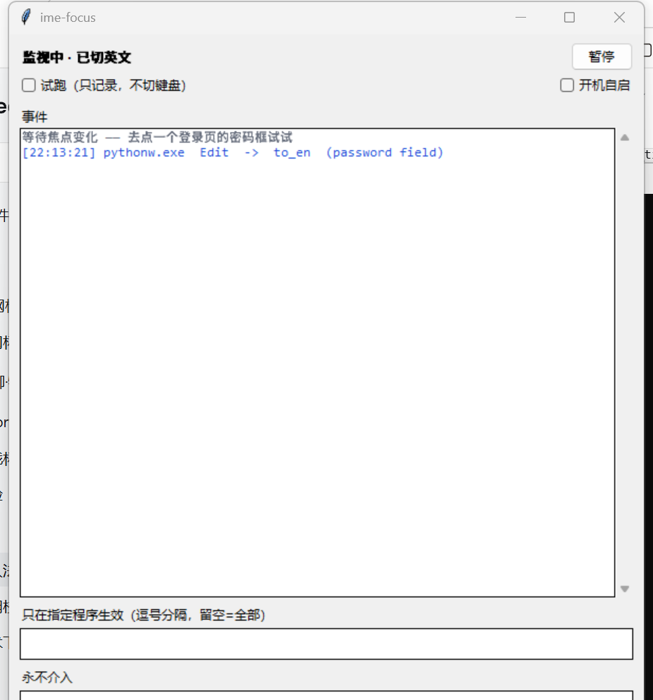

# ime-focus

**焦点守卫：光标进入密码框时自动切英文键盘，离开后切回去。**

> 0.x 实验版，接口和配置格式都会变。

中文输入法下打开登录页、密码框里敲出 `５２０１３１４`、点了"显示密码"发现是中文标点——这个工具就是治它的。

它只做一件事：**看见焦点落在密码框，就把输入法切成英文；焦点离开，切回你原来的。**

平时驻在托盘里，`imefocus gui` 打开设置窗口。也有等价的命令行模式。

## 安装

需要 Python 3.10+ 和 Windows。

```powershell
git clone https://github.com/young-ski/ime-focus
cd ime-focus
pip install -e .
```

**前置条件：系统里得装了「美式键盘」（英语 美国）。**
它靠切换键盘布局工作，没有孤立的英文布局可切就没效果。加一下：设置 → 时间和语言 → 语言和区域 → 添加语言 → 英语（美国），装完只保留「美式键盘」输入法即可。

先跑环境自检：

```powershell
imefocus doctor
```

会告诉你 UIA 能不能用、当前装了哪些布局、有没有美式键盘、要不要管理员权限。

## 用法

### 图形界面

```powershell
imefocus gui
```



窗口里能做的：

- **暂停 / 启用** —— 一键停掉拦截
- **试跑** —— 只记日志不切键盘，先用来验证认得准不准
- **事件区** —— 每次切换和恢复都留痕，带颜色区分
- **只在这些程序里生效 / 永不介入** —— 填进程名，逗号分隔，改完点保存
- **自检** —— 环境有问题直接弹出来
- **开机自启** —— 往计划任务里注册一条登录时启动

最小化到托盘后，左键点图标叫回窗口，右键有「显示窗口 / 启用 / 退出」。启用状态用图标颜色区分（蓝=监视中，灰=已暂停）。

窗口关掉会一并退出，需要常驻就别关，最小化即可。

### 命令行

```powershell
imefocus run --verbose          # 真切换
imefocus run --dry-run -v       # 只打印判断，不动键盘
```

Ctrl+C 退出时会自动切回原布局。

## 配置

`config.example.toml` 复制成 `%APPDATA%\ime-focus\config.toml`：

```toml
enabled = true
interval_ms = 120
# 只在以下进程里生效，留空表示全部程序
only_in = []
# 永不介入
ignore = ["keepass.exe", "bitwarden.exe"]
```

不写配置文件就用内置默认值（全程序生效）。

## 它是怎么判断的

1. 每 120ms 取一次前台焦点元素（UI Automation）。
2. 读 `IsPassword` 属性——浏览器和原生程序都会正确置位，不靠猜标题。原生编辑框的焦点常落在 `InputSiteWindowClass` 包装层上，会沿祖先找到真正置位的控件。
3. 命中就 `PostMessage(WM_INPUTLANGCHANGEREQUEST)` 把该窗口所在线程切到 `00000409`（美式键盘），并记住原来的布局。
4. 焦点离开密码框，把记住的布局换回去。

UIA 调用必须发生在 UI 主线程：自己的窗口属于主线程的 STA，从工作线程调用会被 marshal 回主线程，主线程没泵消息时就死锁。所以轮询是 `after(120ms)` 在主线程驱动的，没有后台线程。

判断逻辑在 `src/imefocus/rules.py`，纯函数、不碰 COM，`tests/` 全覆盖。

## 已知限制

- **UWP / 部分 Electron 应用** 的 UIA 树不完整，可能漏判。
- **管理员权限窗口**（任务管理器、注册表编辑器）默认不可见，需要用管理员身份启动本工具。
- 只切「键盘布局」，不改输入法内部的**中英模式**。如果你只装了微软拼音、没装美式键盘，它切了也没变化。
- 全屏游戏里会有一点开销，可以加进 `ignore`。
- 判断依据是 UIA 属性，安全软件弹窗之类做了防注入的界面可能识别不到。

## 路线图

- [ ] 用 TSF 的 `ActivateProfile` 替代布局切换，解决"只有微软拼音"的场景
- [ ] 记住每个进程的偏好，而非全局一个状态
- [ ] 可选的开机自启也注册托盘恢复（现在只注册启动）
- [ ] 打包成单文件 exe，免 Python 环境

## 许可

MIT
